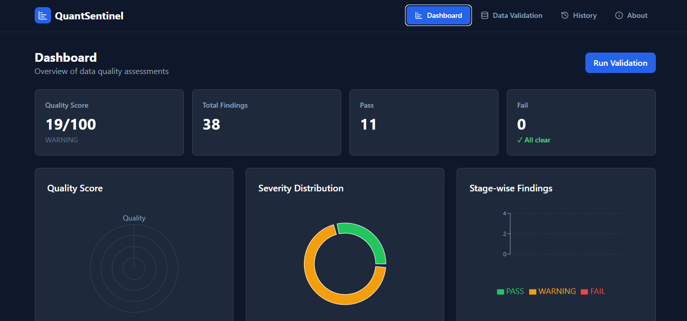
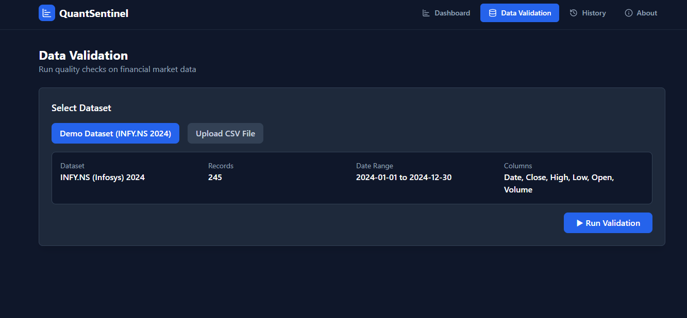
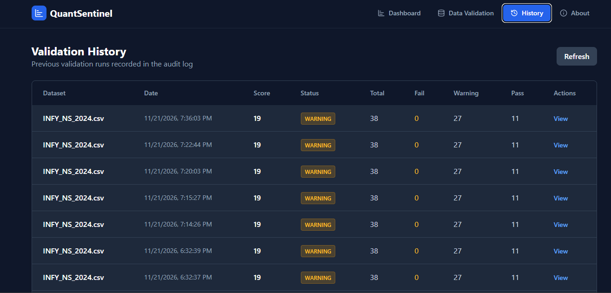
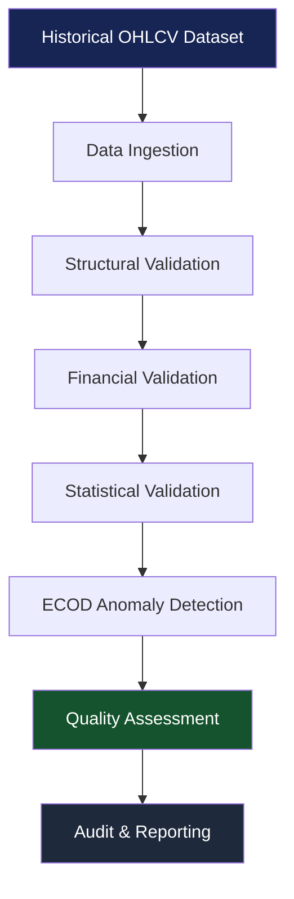

<div align="center">

# ◈ QuantSentinel

### Financial Market Data Quality & Quantitative Research Platform

**Validate with precision. Detect anomalies. Research with confidence.**

A modular platform for financial market data validation, anomaly detection, and quantitative research readiness.

<br/>


<br/>

**[GitHub Repository](https://github.com/akash-g-ai/QuantSentinel)**

</div>

---

## ◈ Overview

Financial research depends on reliable market data. Even small inconsistencies in historical OHLCV datasets can affect statistical analysis, technical indicators, and backtesting results.

**QuantSentinel** addresses this challenge through a structured validation pipeline that combines deterministic data-quality checks with unsupervised anomaly detection.

The platform helps identify:

- Structural inconsistencies in market datasets.
- Invalid financial relationships between OHLC values.
- Unusual returns and volume movements.
- Statistical outliers and potential anomalies.
- Data-quality risks before quantitative research.

---

## ◈ Platform Preview

<p align="center">
  <b>01 — Research Dashboard</b>
</p>

<p align="center">
  
</p>

<p align="center">
  Historical market overview, financial metrics, and research visualisations.
</p>

---

<p align="center">
  <b>02 — Data Validation & Anomaly Detection</b>
</p>

<p align="center">
  
</p>

<p align="center">
  Multi-stage validation results, quality assessment, and ECOD anomaly findings.
</p>

---

<p align="center">
  <b>03 — Validation History</b>
</p>

<p align="center">
  
</p>

<p align="center">
  Historical validation runs and audit records.
</p>

---

## ◈ Core Capabilities

### 01. Structural Validation

Evaluates the structural integrity of historical market datasets.

- Required column verification.
- Missing-value detection.
- Duplicate record identification.
- Data type validation.
- Trading-session gap checks.

### 02. Financial Validation

Checks the consistency of financial market records.

- OHLC relationship validation.
- Invalid and non-positive price detection.
- Volume integrity checks.
- Date and trading-record validation.

### 03. Statistical Validation

Identifies unusual statistical behaviour in historical observations.

- Abnormal return detection.
- Unusual volume movements.
- Robust MAD-based outlier analysis.
- Statistical data-quality warnings.

### 04. ECOD Anomaly Detection

Uses **ECOD (Empirical Cumulative Distribution Functions for Outlier Detection)** through PyOD.

- Unsupervised anomaly detection.
- No pretrained model weights required.
- Detects unusual observations in numerical market features.
- Separates statistical anomalies from deterministic validation failures.

### 05. Data Quality Assessment

Consolidates validation findings into an understandable quality assessment.

| Status | Interpretation |
|---|---|
| PASS | No issue detected by the rule |
| WARNING | Potential data-quality concern |
| FAIL | Validation rule detected an issue |

### 06. Audit & Reporting

- SQLite-based validation history.
- Historical validation run tracking.
- Structured findings and audit records.
- Exportable validation reports.

---

## ◈ Validation Architecture



Each stage contributes findings to the overall assessment. Anomaly detection is reported separately from rule-based validation to avoid treating every unusual observation as invalid data.

---

## ◈ Technology Stack

| Category | Technologies |
|---|---|
| Frontend | React, TypeScript, Vite |
| Styling | Tailwind CSS |
| Backend | Python, FastAPI |
| Data Processing | Pandas, NumPy |
| Machine Learning | PyOD – ECOD |
| Database | SQLite |
| Financial Charts | TradingView Lightweight Charts |
| Visualisation | Recharts |
| Icons | Lucide React |

---

## ◈ Getting Started

### Prerequisites

- Python 3.10+
- Node.js
- npm

### 1. Clone the Repository

```bash
git clone https://github.com/akash-g-ai/QuantSentinel.git
cd QuantSentinel
```

### 2. Backend Setup

```powershell
python -m venv .venv
.\.venv\Scripts\Activate.ps1
pip install -r requirements.txt
```

### 3. Start the Backend

```powershell
python -m uvicorn api.main:app --reload --port 8000
```

Backend:

`http://127.0.0.1:8000`

API Documentation:

`http://127.0.0.1:8000/docs`

### 4. Frontend Setup

Open a separate terminal:

```powershell
cd frontend
npm install
npm run dev
```

Frontend:

`http://localhost:5173`

---

## ◈ Project Structure

```text
QuantSentinel/
│
├── api/
│   └── main.py
│
├── src/
│   └── quantsentinel/
│       ├── ingestion.py
│       ├── structural.py
│       ├── financial.py
│       ├── statistical.py
│       ├── anomaly.py
│       ├── quality.py
│       ├── pipeline.py
│       ├── reporting.py
│       ├── audit.py
│       └── models.py
│
├── frontend/
│   └── src/
│
├── data/
│   ├── raw/
│   ├── validated/
│   └── quarantine/
│
├── requirements.txt
└── README.md
```

---

## ◈ Design Principles

- **Data Integrity:** Preserve original input data and avoid silent modifications.
- **Explainability:** Make validation findings understandable and traceable.
- **Separation of Concerns:** Keep rule-based validation separate from ML anomaly detection.
- **Reproducibility:** Maintain validation history and audit records.
- **Research Readiness:** Focus on data reliability before downstream quantitative analysis.

---

## ◈ Scope & Disclaimer

QuantSentinel is a historical financial data-quality and research-readiness platform.

It does not provide real-time market feeds, investment recommendations, stock-price predictions, or automated trading execution.

All findings depend on the supplied dataset and configured validation methods.

---

## ◈ Author

<div align="center">

### Akash G

**AI & Data Science Engineer**

[](https://github.com/akash-g-ai)
[](https://www.linkedin.com/in/akash-g-fullstack/)

<br/>

*QuantSentinel — Building confidence in financial data, one validation at a time.*

</div>
